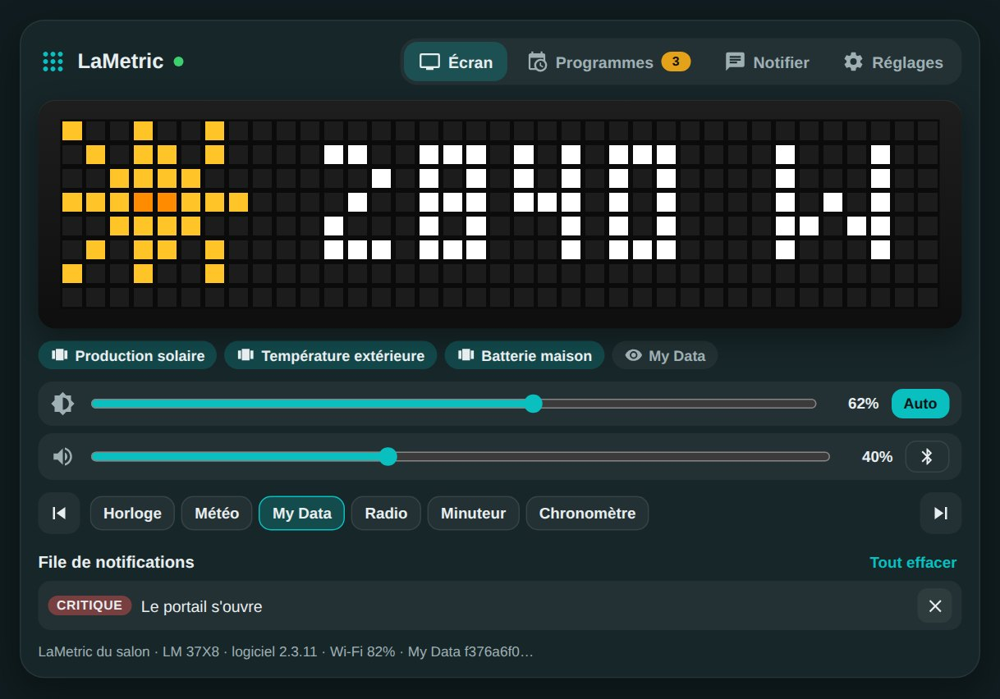
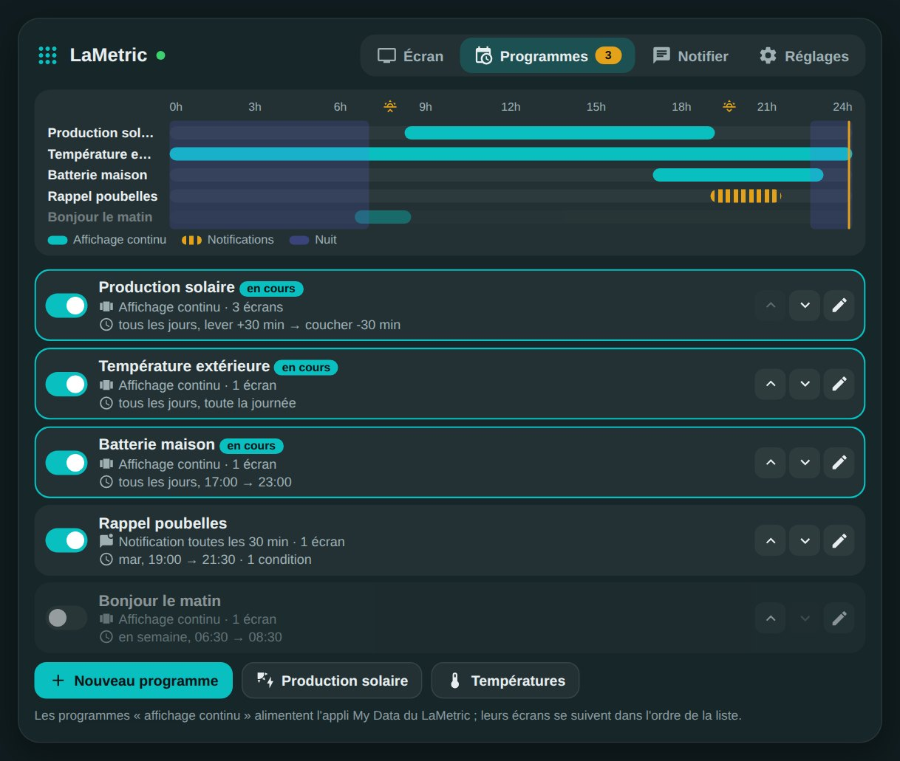
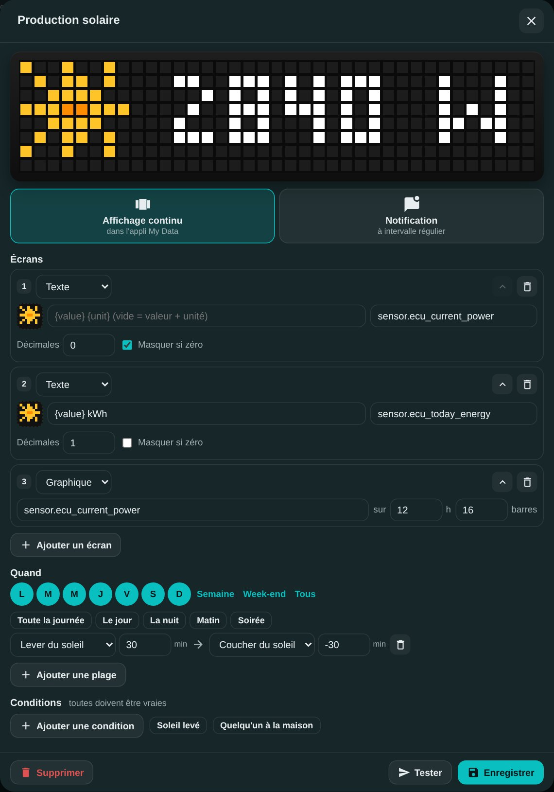
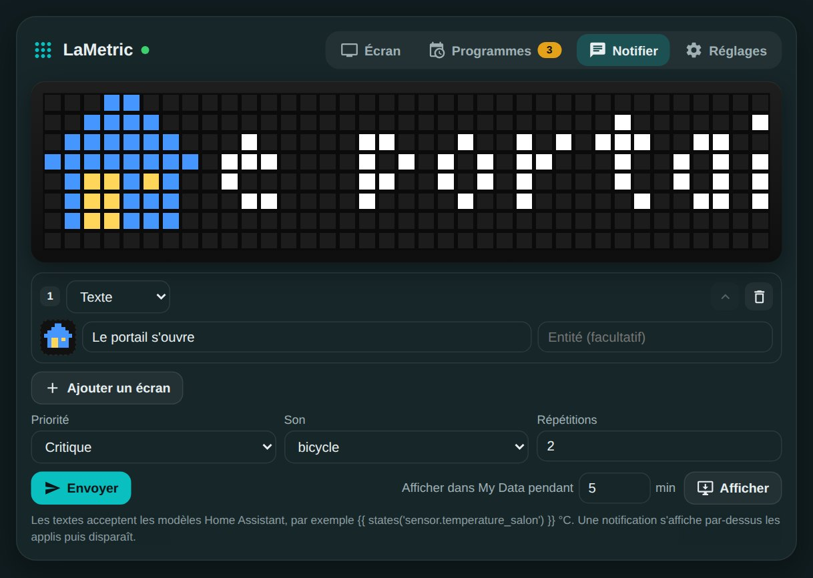

# 🟨 HOLM LaMetric

[](https://hacs.xyz/)


[🇫🇷 Français](README.md) · 🇬🇧 English

**The whole LaMetric Time in Home Assistant, plus programmes to decide what to show, and when.**

HOLM LaMetric replaces the official LaMetric integration. It drives the clock through its **local API**: brightness, volume, apps, alarm, timer, radio, rich notifications. Above all, it adds **programmes**: solar production scrolls all day but stops in the evening, the outdoor temperature stays on screen, the home battery shows up at the end of the day, a reminder arrives on Tuesday evening… all set up from a card, no YAML.

> ✨ **The card ships with the integration**: no Lovelace resource to add. The settings of the official integration are imported in one click.

> 🌍 Integration and card are available in **8 languages** (French, English, German, Spanish, Italian, Dutch, Portuguese, Polish) and follow your Home Assistant language.



| Programmes | A programme |
|---|---|
|  |  |

### At a glance

- 🗓️ **Programmes**:
  - **continuous display**: the screens of active programmes scroll in the LaMetric's **My Data** app, updated as soon as a value changes;
  - **notification**: sent every X minutes, or once at the start of each time slot;
  - active depending on **days**, **time slots** (fixed time, sunrise or sunset with an offset, slots that cross midnight) and **conditions** on your entities;
  - a **24-hour timeline** shows what is displayed when.
- 🖼️ **Screens**: text (with Home Assistant templates or an entity's value), **gauge** (a battery, a goal), **chart** of an entity's history. "Hide if zero" option for solar production at night.
- 🔎 **The ~74,000 LaMetric icons** can be searched by name right in the card.
- 🌙 **Night mode**: only important notifications get through, silently, and brightness drops, then comes back in the morning.
- 🔔 **Rich notifications**: several screens, priority, sound (or MP3), repeats, lifetime. Night mode can also apply to your automations, if you wish.
- 🎛️ **The whole device**: brightness and auto mode, volume, Bluetooth, screensaver, displayed app, next or previous app, alarm, timer, stopwatch, radio, clock face.
- 👀 **The card** shows live what the LaMetric displays, on a faithful LED screen (37 × 8), with quick settings and the notification queue.

---

## Contents

- [Installation](#installation)
- [Configuration](#configuration)
- [The `holm-lametric-card` card](#the-holm-lametric-card-card)
- [Programmes](#programmes-1)
- [Night mode](#night-mode)
- [Actions](#actions)
- [Coming from the official integration](#coming-from-the-official-integration)
- [Entities](#entities)
- [FAQ / troubleshooting](#faq--troubleshooting)

---

## Installation

### Via HACS (recommended)

1. HACS → ⋮ menu → **Custom repositories** → add `https://github.com/kaaribou/lametric-holm`, category **Integration**.
2. Search for **HOLM LaMetric** and install it.
3. Restart Home Assistant.

### Manual

Copy the `custom_components/lametric_holm` folder into the `custom_components` folder of your configuration, then restart Home Assistant.

---

## Configuration

### 1. Prepare the LaMetric

For continuous display, install the **My Data DIY** app on the LaMetric (from the LaMetric mobile app, "Apps" section), then set it up like this:

- **Type**: `HTTP Push`;
- **Data Format**: `Predefined (LaMetric Format)`.

The integration finds it on its own. Without it, everything works except the continuous display of programmes.

### 2. Add the integration

**Settings → Devices & services → Add integration → HOLM LaMetric.**

- If the **official LaMetric** integration is already configured, choose to import its settings: the address and API key are taken over, nothing to type.
- Otherwise, enter the LaMetric's **IP address** and its **API key** (on [developer.lametric.com](https://developer.lametric.com), *Devices* section).

Both integrations can run side by side while you migrate your automations.

### Options

| Option | Purpose | Default |
|---|---|---|
| Polling interval | How often the LaMetric's state is read | 30 s |
| My Data app | My Data widget used for continuous display, if you have several | Automatic |

---

## The `holm-lametric-card` card

```yaml
type: custom:holm-lametric-card
```

| Option | Values | Default |
|---|---|---|
| `title` | text | `LaMetric` |
| `view` | `full` (tabs) · `screen` (screen and quick settings only) | `full` |
| `tab` | tab on opening: `screen` · `programmes` · `notify` · `settings` | `screen` |
| `show_frame` | `false` for a frameless card | `true` |
| `entry_id` | to target a specific LaMetric if you have several | the first one |
| `language` | `fr` · `en` · `de` · `es` · `it` · `nl` · `pt` · `pl` | Home Assistant profile language |

Four tabs:

- **Screen**: what My Data is showing right now, running programmes, brightness, volume, Bluetooth, the apps (one click to switch) and the notification queue.
- **Programmes**: the day's timeline, the list of programmes (enable, reorder, edit) and two ready-made templates, **Solar production** and **Temperatures**, which find your sensors on their own.
- **Notify**: compose a notification and send it, or show it for a few minutes in My Data.
- **Settings**: global pause of programmes, idle screen, night mode, default sound, app scrolling mode, screensaver.



---

## Programmes

A programme is **what to show** (screens) and **when** (days, time slots, conditions).

### Two ways to display

| Mode | What happens |
|---|---|
| **Continuous display** | While the programme is active, its screens are sent to the My Data app. The screens of all active programmes follow one another in list order. When none is active, the **idle screen** takes over. |
| **Notification** | While the programme is active, a notification is sent every X minutes. With an interval of 0, it is sent only once at the start of each time slot. |

### Screens

| Type | Content |
|---|---|
| **Text** | Fixed text, a template (`{{ states('sensor.x') }}`), or an entity's value (its state or one of its attributes, e.g. the temperature of a weather entity). With an entity, `{value}` and `{unit}` go wherever you like (`Living {value}°`); left empty, the text shows the value and its unit. Adjustable decimals, "hide if zero" option. |
| **Gauge** | An entity's value between a start and a goal, with a progress bar. |
| **Chart** | An entity's history over the last X hours, as bars. |

Entities are picked in a search window (name, room or ID, filters by type). Once the entity is chosen, a list lets you use its **state** or one of its **attributes**: for a weather entity, temperature, humidity, pressure or wind; the unit follows automatically.

Each screen can have a LaMetric icon: click the icon box and search by name (*sun*, *battery*, *car*…), or type its code directly (`i1234`, `a1234`).

### When

- **Days** of the week.
- **Time slots**: start and end at a fixed time, or at sunrise / sunset with an offset in minutes. A slot can cross midnight (22:30 → 07:00). Without a slot, the programme is active all day. Shortcuts: *Daytime*, *Night-time*, *Morning*, *Evening*.
- **Conditions** on entities or their attributes (=, ≠, >, <, ≥, ≤): all must be true. Shortcuts: *Sun up*, *Someone home*.

The preview at the top of the editor shows the real values, just like on the LaMetric.

---

## Night mode

In the **Settings** tab, or with the night mode switch (`switch.holm_lametric_…`):

- night **time slot** (fixed time or sun);
- **allowed notifications**: critical only, or important and critical;
- **silent** at night, except for critical ones;
- **night brightness** (optional): applied when night starts, the previous value comes back in the morning;
- **apply to automations**: the filter also applies to `lametric_holm.notify` and the `notify` entity (unless `ignore_night: true`).

---

## Actions

The `device` parameter is optional if you only have one LaMetric.

### `lametric_holm.notify`

```yaml
action: lametric_holm.notify
data:
  message: "The gate is opening"
  icon: i4516
  priority: critical        # info · warning · critical (wakes the screen)
  sound: bicycle            # LaMetric sound, or the URL of an MP3
  cycles: 2
```

Several screens, with gauge and chart:

```yaml
action: lametric_holm.notify
data:
  frames:
    - text: "Production {{ states('sensor.ecu_current_power') }} W"
      icon: a72455
    - type: goal
      entity: sensor.battery
      end: 100
      unit: "%"
    - type: chart
      entity: sensor.ecu_current_power
      hours: 12
```

Other fields: `icon_type` (none, info, alert), `repeat` (sound repeats), `lifetime` (seconds), `ignore_night`. The action returns the notification ID.

### Other actions

| Action | Purpose |
|---|---|
| `lametric_holm.dismiss` | Clears the displayed notification, one notification (`id`) or all of them (`all: true`) |
| `lametric_holm.push_frames` | Shows screens in My Data for X minutes, instead of the programmes |
| `lametric_holm.programme` | Enables, disables or immediately shows a programme (by name) |
| `lametric_holm.activate_app` | Switches to an app (`app: Weather`) |
| `lametric_holm.alarm` | Sets the alarm (`time`, `enabled`, `wake_with_radio`) |
| `lametric_holm.timer` | Timer: `start` with a `duration`, `pause`, `reset` |
| `lametric_holm.stopwatch` | Stopwatch: `start`, `pause`, `reset` |
| `lametric_holm.radio` | Radio: `play`, `stop`, `next`, `prev` |
| `lametric_holm.clockface` | Clock face: `weather`, `page_a_day`, `none`, or an icon |
| `lametric_holm.app_action` | Any app action (package, action, parameters) |

---

## Coming from the official integration

1. Add HOLM LaMetric, importing the settings of the official integration.
2. Replace in your automations:

| Before | After |
|---|---|
| `notify.<lametric>` with `data: {icon, sound, priority, cycles, icon_type}` | `lametric_holm.notify` with `message`, `icon`, `sound`, `priority`, `cycles`, `icon_type` at the same level |
| `lametric.message` (`device_id`, `message`, `icon`…) | `lametric_holm.notify` (without `device_id`) |
| `lametric.chart` | `lametric_holm.notify` with a `chartData` screen or `type: chart` |

   Icons in the official integration's format (`4516`) are accepted as is.
3. Remove the official integration. If Home Assistant offers it again under "Discovered", click "Ignore".

---

## Entities

Entities are named `<domain>.holm_lametric_…`:

| Entity | Purpose |
|---|---|
| `number` Brightness, Volume | Settings (setting the brightness switches to manual mode) |
| `select` Brightness mode, App scrolling, Displayed app | |
| `switch` Bluetooth, Screensaver | |
| `switch` Programmes | Pauses all programmes |
| `switch` Night mode | `in_night` attribute: is it night right now |
| `button` Next / previous app, Dismiss notification, Dismiss all notifications | |
| `sensor` Current app, Pending notifications, Active programmes | Active programmes list their names as an attribute |
| `sensor` Wi-Fi signal, Firmware, IP address | Diagnostic |
| `notify` Notification | For `notify.send_message` |

---

## FAQ / troubleshooting

**"My Data DIY app not found" in the card.**
Install *My Data DIY* on the LaMetric and set it to `HTTP Push`. It is detected at the next poll (2 minutes at most).

**An "info" notification doesn't show.**
When the screensaver is active, the LaMetric only shows **critical** notifications. HOLM LaMetric's night mode may also hold them back.

**Icons in the search don't appear right away.**
The first search downloads the LaMetric catalogue (~74,000 icons), a few seconds. It is kept for a week in Home Assistant.

**Accents or emojis look wrong on the LaMetric.**
The LaMetric screen doesn't know emojis; accented letters depend on the clock's firmware. The card preview shows letters without accents.

> API and icons: [LaMetric](https://lametric.com). Independent project, not affiliated with LaMetric.

---

## Say thanks?

Like the integration? You can buy me a beer 🍺

[](https://paypal.me/kaaribou)

---

## License

Code: **MIT** license — © kaaribou. See the [CHANGELOG](CHANGELOG.md) (in French).

Part of **HOLM — Home Orchestration & Living Management**: smart management and orchestration of the home.

Other projects: [Carburant HOLM](https://github.com/kaaribou/carburant-holm) · [Climat HOLM](https://github.com/kaaribou/climat-holm) · [Volets HOLM](https://github.com/kaaribou/volets-holm) · [HOLM HP/HC](https://github.com/kaaribou/holm-tarif) · [HOLM Lektrico](https://github.com/kaaribou/lektrico-holm) · [HOLM My Menu](https://github.com/kaaribou/holm-mymenu) · [HOLM Cars](https://github.com/kaaribou/holm-cars) · [HOLM GitHub](https://github.com/kaaribou/github-holm) · [HOLM Navbar Card](https://github.com/kaaribou/holm-navbar-card) · [HOLM Climate Card](https://github.com/kaaribou/climate-card-holm) · [HOLM Music Card](https://github.com/kaaribou/holm-music-card) · [HOLM Energy Cards](https://github.com/kaaribou/holm-energy-cards) · [HOLM Power Flow Card](https://github.com/kaaribou/holm-power-flow-card) · [HOLM Ecojoko Card](https://github.com/kaaribou/holm-ecojoko-card) · [HOLM Runtime Card](https://github.com/kaaribou/holm-runtime-card) · [HOLM Covers Card](https://github.com/kaaribou/holm-covers-card) · [HOLM Floor Card](https://github.com/kaaribou/holm-floor-card) · [HOLM Radiator Card](https://github.com/kaaribou/holm-radiator-card) · [HOLM Security Card](https://github.com/kaaribou/holm-security-card) · [HOLM Sentinel Card](https://github.com/kaaribou/holm-sentinel-card) · [HOLM Recordings Card](https://github.com/kaaribou/holm-recordings-card) · [HOLM Smoke Card](https://github.com/kaaribou/holm-smoke-card) · [HOLM Family Card](https://github.com/kaaribou/holm-family-card) · [HOLM Govee Light Card](https://github.com/kaaribou/holm-govee-light-card) · [HOLM Leapmotor Card](https://github.com/kaaribou/holm-leapmotor-card).
